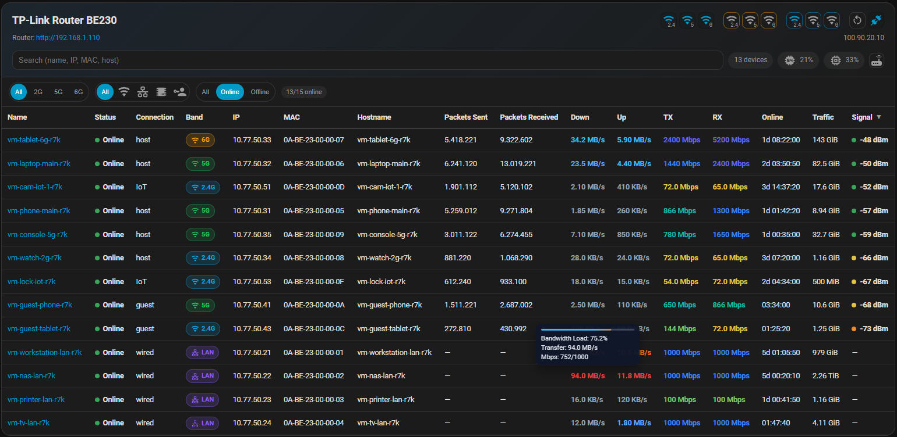
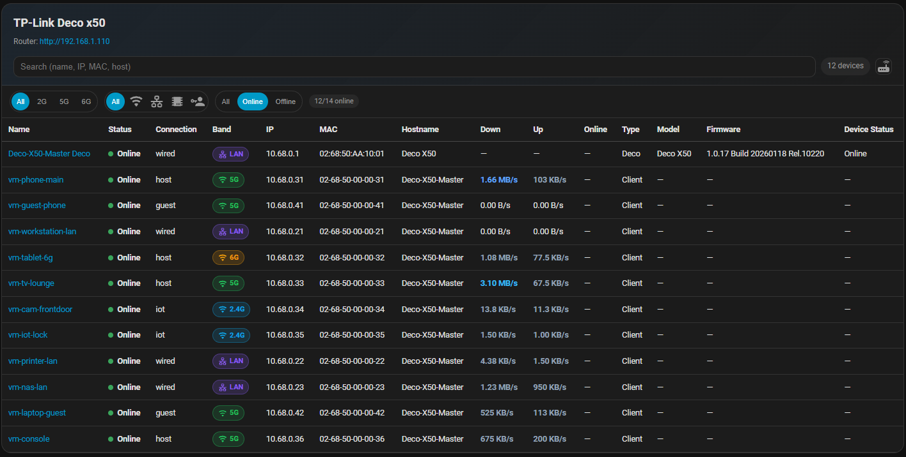
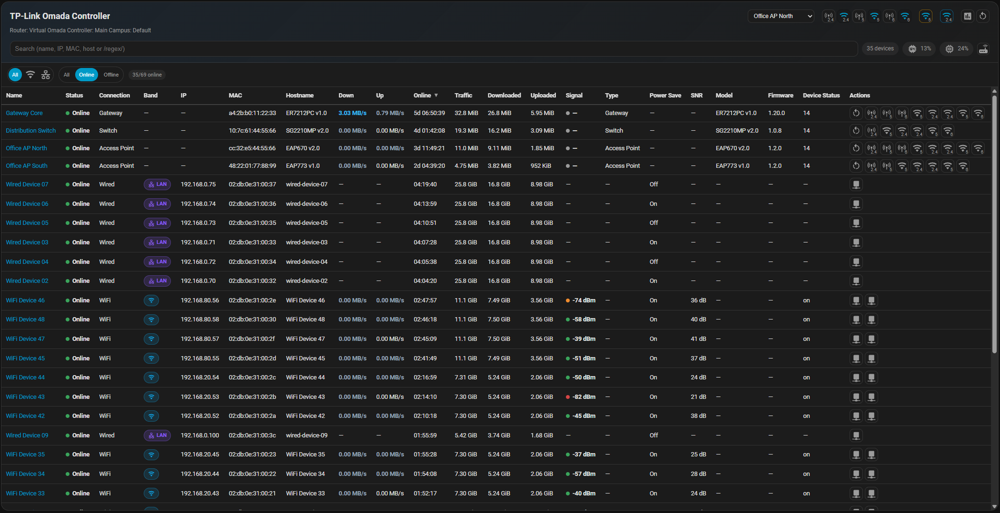
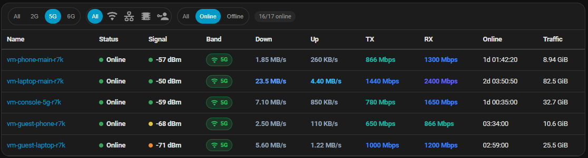
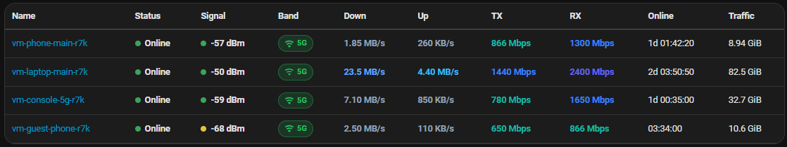
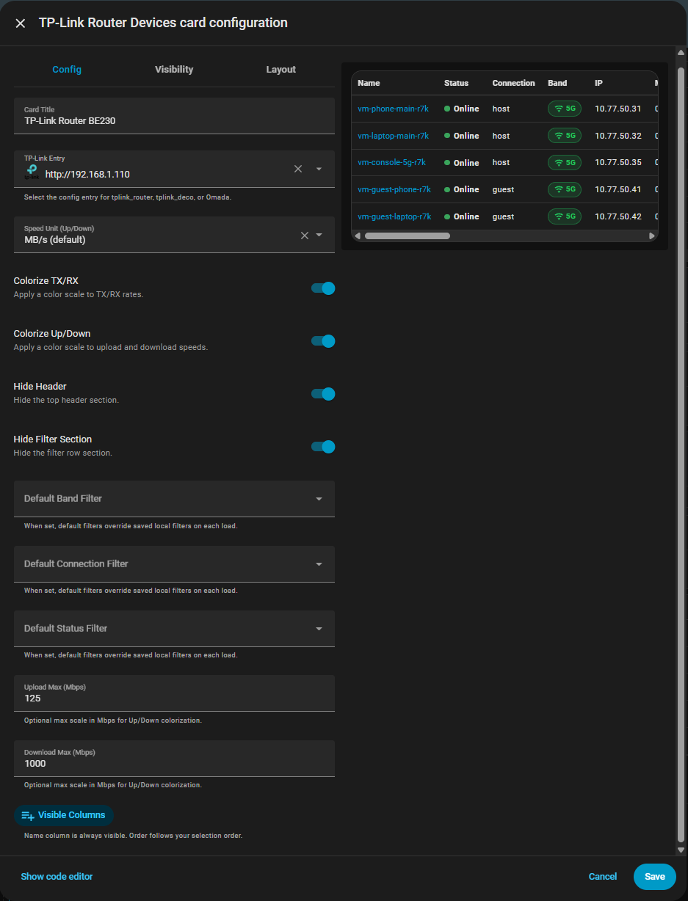

# HA TP-Link Router Card

[](https://github.com/custom-components/hacs)
[](https://github.com/hepter/ha-tplink-router-card/releases)
[](https://github.com/hepter/ha-tplink-router-card/releases/latest)
[](https://github.com/hepter/ha-tplink-router-card/releases)
[](https://github.com/hepter/ha-tplink-router-card/blob/main/LICENSE)

A Lovelace card for Home Assistant focused on TP-Link client monitoring and quick router controls.



⭐ Found it useful? Please star the repo to support development and help others discover it.

## ✨ Features

**📊 Rich Data Visualization**
- **Live Client Table:** Real-time mapping directly from router `device_tracker` entities.
- **Access Point Column:** See which mesh node / access point each client is attached to (`tplink_router` EasyMesh, `tplink_deco`, `omada`, `omada_open_api`), with a badge for clients on the main router.
- **Smart Formatting:** Human-readable formatting for traffic, link rates, duration, and signal quality.
- **Colorized Metrics:** Optional color scales for TX/RX and Up/Down speeds for quick visual scanning.
- **Signal Quality:** `omada_open_api` clients get the controller's signal quality percentage as a coloured bar next to RSSI; Omada rows can also show SSID, the connected AP / switch, vendor, per-device client count, CPU / memory load, uplink and a pending firmware update badge.
- **Advanced Tooltips:** Hover over Up/Down speeds for a detailed utilization bar, bandwidth load percentage, adaptive transfer units, and current/max Mbps.

**🎛️ Interactive Controls & Actions**
- **Router Dashboard:** Header featuring local URL, public IP, CPU/MEM summary, and quick actions.
- **Customizable Actions:** Row-level and header-level actions with flexible rendering modes (`icon`, `name`, `icon_name`).
- **Grouped Header Actions:** Header actions are grouped (WiFi, Guest WiFi, IoT WiFi, Reboot, Data fetching, Controller, VPN, DHCP server, WAN) and `header_action_groups` decides which groups are shown; groups that can lock you out are off by default.
- **Hold-to-Confirm:** 1-second hold requirement for destructive actions to prevent accidental clicks.
- **Visual State Feedback:** Explicit state coloring for toggle actions.
- **Haptic Feedback:** Built-in vibration feedback on supported mobile/webview environments during interactions.

**🖱️ Advanced Navigation & Shortcuts**
- **Shift + Click Entity Access:** Hold `Shift` and click on metric cells (like speed, traffic, signal) to instantly open the underlying Home Assistant entity's more-info dialog.
- **Name-Cell Navigation:** Click a device name to open its entity more-info (`tplink_router` / `tplink_deco`) or device page (`omada` / `omada_open_api` / `tplink_omada`).
- **Inline Shortcuts:** Quick device shortcut icons directly in the Name column.

**🎨 Flexible & Responsive Layout**
- **Powerful `column_layout`:** Define exact column order, custom headers, and per-column `max_width` (`px`, `%`, `vw`, `clamp()`, etc.).
- **Sticky Columns:** Pin columns to the start or end of the table with elegant edge shadow indicators during horizontal scroll.
- **Responsive Design:** Header and action layouts adapt perfectly across desktop, tablet, and mobile screens.
- **Headless Modes:** Hide the header or filter sections for a compact, table-only dashboard view.

**🔍 Search, Filter & Sort**
- **Fast Search:** Real-time search across name, IP, hostname, and MAC address.
- **Regex Support:** Use `/pattern/` syntax in the search box for advanced filtering.
- **Quick Filters:** Compact dropdowns for Band (2.4G/5G/6G), Connection (WiFi/Wired/IoT/Guest), and Status.
- **Multi-Sort:** `Shift + click` on column headers to sort by multiple columns simultaneously.

**🌍 Global & Developer Features**
- **i18n Support:** Automatic Home Assistant locale selection (English, Turkish, etc.), including connection, device type and status labels.
- **Diagnostics Export:** Built-in, redacted JSON export for easy bug reporting and troubleshooting.

## Screenshots
`tplink_router`:


`tplink_deco`:



`omada` / `tplink_omada`:



Header variants (`hide_header` / `hide_filter_section` options):

Headless layout: the filter row stays visible while the header is hidden.



Headless + no filter layout: both header and filter row are hidden for a compact table-only card.



## Compatibility
- Supported integrations:
  - [`home-assistant-tplink-router`](https://github.com/AlexandrErohin/home-assistant-tplink-router) (`tplink_router`)
  - [`ha-tplink-deco`](https://github.com/amosyuen/ha-tplink-deco) (`tplink_deco`)
  - [`ha-omada`](https://github.com/zachcheatham/ha-omada) (`omada`)
  - [`ha-omada-open-api`](https://github.com/bullitt186/ha-omada-open-api) (`omada_open_api`)
  - Home Assistant Core `tplink_omada` (`tplink_omada`)

Support level summary:
- `tplink_router`: full support
- `tplink_deco`: high support
- `omada`: high support
- `omada_open_api`: high support
- `tplink_omada`: basic support (Home Assistant Core publishes only a small client attribute set)

Detailed matrix: `docs/integration-support.md`

- `tplink_router`:
  - Full client table mapping from router tracker attributes.
  - EasyMesh: the optional `apName` column shows the node each client is attached to (integration v2.33.0+), clients on the main router get a badge. Add `apName` to `column_layout` to enable it.
  - Header action groups: WiFi and Guest WiFi bands, reboot and data fetching are shown by default; IoT bands, VPN server/client and the LAN DHCP server switch exist but stay hidden until listed in `header_action_groups` (all hold to confirm).

- `tplink_deco`:
  - Client/deco table mapping from `device_tracker.*` entities.
  - Supports `connection_type` and `interface` mapping.
  - Upload/download speed values are normalized automatically.
  - Optional `apName` shows the parent Deco of each client; `hostname` uses the raw client name (`ui_device_name`, integration v3.8.0+).
  - Deco nodes show their mesh role in `deviceType` (`Deco (Master)` / `Deco (Satellite)`).
  - The integration's `Polling` switch is offered in the `scanning` header group.

- Omada (`omada`, HACS `ha-omada`):
  - Device-based row mapping with controller client data.
  - Per-row actions (`actions` column) from matched `switch.*` / `button.*` entities. The unnamed client block switch is detected and always requires a hold.
  - Header action target selector for infrastructure devices.
  - Metric/entity bridge for Omada-only fields with Shift+click cell info.
  - Numeric device `status` / `status_category` codes are shown as labels (`Connected`, `Heartbeat Missed`, `Configuring`, ...); access point rows list their radios (`2.4G/5G/6G`) in `band`.
  - Extra Omada columns:
    - `downloaded`, `uploaded`, `snr`, `powerSave`
    - `deviceType`, `deviceModel`, `deviceFirmware`, `deviceStatus` (a pending firmware update shows a badge in `deviceFirmware`)
    - optional (add to `column_layout`): `apName`, `channel`, `wifiMode`, `lastSeen`, `ssid`, `connectedTo` (AP for wireless, switch for wired clients), `cpu`, `memory` (device rows)

- Omada (`omada_open_api`, HACS `ha-omada-open-api`):
  - Client rows come from the integration's trackers (`connection_type`, `connected_ap`, `connected_switch`, `ssid`) joined with the per-client sensors (RSSI, SNR, downloaded/uploaded, RX/TX activity, uptime) and the `Power save` binary sensor.
  - Access points, switches and the gateway are rows too: `deviceType`, `deviceModel`, `deviceFirmware` and `deviceStatus` come from the device tracker attributes; the site pseudo device is not listed.
  - The `actions` column offers the client `Network access` switch as the block action (hold to confirm) and the `Reconnect` button. The integration's switch is on while the client is allowed; the card shows it in the same blocked/allowed colours as the other Omada integrations.
  - Header actions: AP radio switches (`2.4 GHz radio`, `5 GHz radio`, `6 GHz radio`) in `wifi`, per-AP SSID switches by SSID name (`wifi` / `guest` / `iot`), device `Reboot` buttons, and the site `WLAN optimization` button in `controller`.
  - `signalStrength` shows the controller's signal quality (the integration's `Signal strength` percentage sensor) as a coloured bar next to the RSSI `signal` column; it is part of the default layout for this integration.
  - Extra columns: `downloaded`, `uploaded`, `snr`, `powerSave`, `deviceType`, `deviceModel`, `deviceFirmware` (with a badge when the `update` entity reports a newer firmware), `deviceStatus`; optional `apName`, `ssid`, `connectedTo` (AP, switch or gateway name), `vendor` (client manufacturer from the device registry), `clients` (connected client count of an AP / switch / gateway), `cpu`, `memory`, `uplink` (uplink device and port of an AP / switch). `channel`, `wifiMode`, `lastSeen`, packet counters (`packetsSent`, `packetsReceived`) and link rates (`tx`, `rx`) are not published by the integration and are not offered.
  - Entities exist only for the clients selected in the integration's config flow (`selected_clients`).

- Omada (`tplink_omada`, Home Assistant Core):
  - Client rows come from the core scanner entities (name, hostname, IP, MAC, status only); all clients are wireless.
  - Device rows (gateway / switch / access point) use the device registry for `deviceType`, `deviceModel`, `deviceFirmware`, `deviceStatus`.
  - The `actions` column offers "Reconnect client" (hold to confirm) through the `tplink_omada.reconnect_client` service.
  - Gateway `WAN connect` switches are offered in the hidden-by-default `wan` header group; port PoE switches appear as row actions of the switch device and require a hold.
  - `apName`, `channel`, `wifiMode`, `lastSeen`, `snr`, `powerSave`, `downloaded`, `uploaded` are not available from core and are not offered.

Notes:
- Available actions and sensors depend on model, firmware, and integration-exposed entities.
- If an action cannot be matched safely, it is hidden by design.
- Integration-specific attributes are parsed with safe fallbacks. Missing fields never crash the card and are rendered as `—`.
- Online detection accepts any tracker state other than `not_home` / `unavailable` / `unknown`, so trackers associated with a custom Home Assistant zone (core 2026.6+) still count as connected.

## Installation

### 1. Add directly to HACS (recommended)

[](https://my.home-assistant.io/redirect/hacs_repository/?owner=hepter&repository=ha-tplink-router-card&category=plugin)

### 2. HACS (manual path)
1. Open HACS.
2. Add this repository as a **Dashboard** custom repository.
3. Install **HA TP-Link Router Card**.
4. Verify resource exists:
   - `/hacsfiles/ha-tplink-router-card/ha-tplink-router-card.js`
   - Type: `JavaScript Module`

### Beta versions
Pre-releases (tags such as `v0.5.0-beta.1`) are published as GitHub pre-releases. To install one from HACS, open the card in HACS, use the three-dot menu, enable **Show beta versions**, then pick the beta from the version list.

### 3. Manual
Download the latest release asset and place it under:
- `/config/www/ha-tplink-router-card/ha-tplink-router-card.js`

CLI example:
```bash
mkdir -p /config/www/ha-tplink-router-card
wget -O /config/www/ha-tplink-router-card/ha-tplink-router-card.js \
  https://github.com/hepter/ha-tplink-router-card/releases/latest/download/ha-tplink-router-card.js
```

Add resource (YAML):
```yaml
resources:
  - url: /local/ha-tplink-router-card/ha-tplink-router-card.js?v=1
    type: module
```

UI path:
- Settings → Dashboards → Resources → Add Resource

## Configuration
Minimal:
```yaml
type: custom:tplink-router-card
```

Generic example:
```yaml
type: custom:tplink-router-card
title: My Router
entry_id: <config_entry_id>
speed_unit: MBps
txrx_color: true
updown_color: true
show_hidden_entities: false
header_action_render: icon
row_action_render: icon
header_action_groups:
  - wifi
  - guest
  - reboot
  - scanning
  - controller
shift_click_underline: true
hide_header: false
hide_filter_section: false
default_filters:
  band: all
  connection: all
  status: all
upload_speed_color_max: 1000
download_speed_color_max: 100
column_layout:
  - key: name
    fixed: start
    max_width: 140px
  - key: status
  - key: connection
  - key: band
  - key: ip
  - key: mac
  - key: hostname
  - key: down
  - key: up
```

Cross-integration safe baseline `column_layout`:
```yaml
column_layout:
  - key: name
  - key: status
  - key: connection
  - key: band
  - key: ip
  - key: mac
  - key: hostname
  - key: down
  - key: up
```

Integration-specific extra keys (rendered by default when no `column_layout` is set):
```yaml
# tplink_router
- packetsSent
- packetsReceived
- tx
- rx
- online
- traffic
- signal

# omada (HACS ha-omada)
- downloaded
- uploaded
- snr
- powerSave
- actions

# omada_open_api (HACS ha-omada-open-api)
- signalStrength
- downloaded
- uploaded
- snr
- powerSave
- actions

# tplink_omada (core)
- actions

# tplink_deco / omada / omada_open_api / tplink_omada metadata
- deviceType
- deviceModel
- deviceFirmware
- deviceStatus
```

Optional keys, never part of the default layout, add them to `column_layout` when you need them:
```yaml
# tplink_router (EasyMesh node), tplink_deco (parent Deco), omada / omada_open_api (access point)
- apName

# omada (HACS ha-omada) only
- channel    # wireless channel
- wifiMode   # WiFi 4/5/6/7 generation
- lastSeen   # last time a disconnected client was seen

# omada / omada_open_api
- ssid         # SSID of a wireless client
- connectedTo  # access point, switch or gateway the client hangs off
- cpu          # CPU load of an access point / switch / gateway row
- memory       # memory load of an access point / switch / gateway row

# omada_open_api only
- vendor   # client manufacturer
- clients  # connected client count of an access point / switch / gateway row
- uplink   # uplink device and port of an access point / switch row
```

### Recommended column presets by integration

For YAML users, define the full order with `column_layout`.

`tplink_router` (recommended)
```yaml
type: custom:tplink-router-card
entry_id: <tplink_router_entry_id>
column_layout:
  - key: name
    fixed: start
  - key: status
  - key: connection
  - key: band
  - key: ip
  - key: mac
  - key: hostname
  - key: packetsSent
  - key: packetsReceived
  - key: down
  - key: up
  - key: tx
  - key: rx
  - key: online
  - key: traffic
  - key: signal
```

`tplink_deco` (recommended)
```yaml
type: custom:tplink-router-card
entry_id: <tplink_deco_entry_id>
column_layout:
  - key: name
    fixed: start
  - key: status
  - key: connection
  - key: band
  - key: ip
  - key: mac
  - key: hostname
  - key: down
  - key: up
  - key: deviceType
  - key: deviceModel
  - key: deviceFirmware
  - key: deviceStatus
```

`omada` (HACS `ha-omada`, recommended)
```yaml
type: custom:tplink-router-card
entry_id: <omada_entry_id>
column_layout:
  - key: name
    fixed: start
  - key: status
  - key: connection
  - key: band
  - key: ip
  - key: mac
  - key: hostname
  - key: down
  - key: up
  - key: online
  - key: downloaded
  - key: uploaded
  - key: traffic
  - key: signal
  - key: snr
  - key: powerSave
  - key: deviceType
  - key: deviceModel
  - key: deviceFirmware
  - key: deviceStatus
  - key: actions
```

`omada_open_api` (HACS `ha-omada-open-api`, recommended)
```yaml
type: custom:tplink-router-card
entry_id: <omada_open_api_entry_id>
column_layout:
  - key: name
    fixed: start
  - key: status
  - key: connection
  - key: band
  - key: ssid
  - key: connectedTo
  - key: ip
  - key: mac
  - key: hostname
  - key: vendor
  - key: down
  - key: up
  - key: online
  - key: downloaded
  - key: uploaded
  - key: traffic
  - key: signal
  - key: signalStrength
  - key: snr
  - key: powerSave
  - key: deviceType
  - key: deviceModel
  - key: deviceFirmware
  - key: deviceStatus
  - key: clients
  - key: cpu
  - key: memory
  - key: uplink
  - key: actions
```

`tplink_omada` (Home Assistant Core, recommended)
```yaml
type: custom:tplink-router-card
entry_id: <tplink_omada_entry_id>
column_layout:
  - key: name
    fixed: start
  - key: status
  - key: connection
  - key: ip
  - key: mac
  - key: hostname
  - key: deviceType
  - key: deviceModel
  - key: deviceFirmware
  - key: deviceStatus
  - key: actions
```

Mesh / access point view (any integration that reports the node, add the optional keys you need):
```yaml
type: custom:tplink-router-card
entry_id: <entry_id>
column_layout:
  - key: name
    fixed: start
  - key: status
  - key: apName
  - key: band
  - key: channel      # omada only
  - key: wifiMode     # omada only
  - key: signal
  - key: lastSeen     # omada only
```

Options:
- `title`: Card title.
- `entry_id`: Config entry to use. Selected from editor.
- `speed_unit`: `MBps` (default) or `Mbps` for Up/Down columns.
- `txrx_color`: Enable colorized TX/RX speed levels.
- `updown_color`: Enable colorized upload/download speeds.
- `show_hidden_entities`: Show hidden switch/button entities in action areas. Default `false`.
- `header_action_render`: Header action button style: `icon | name | icon_name`. Default `icon`. Works across all supported integrations when header actions exist.
- `row_action_render`: Row action button style: `icon | name | icon_name`. Default `icon`. Currently effective for Omada row actions (`omada` / `omada_open_api` / `tplink_omada`).
- `header_action_groups`: Which header action groups to show. Keys: `wifi`, `guest`, `iot`, `reboot`, `scanning`, `controller`, `vpn`, `dhcp`, `wan`; `all` shows everything, an empty list hides every header action. Default `[wifi, guest, reboot, scanning, controller]`. See "Header action groups" below.
- `shift_click_underline`: Show Shift+click underline hints for entity-clickable cells (currently Omada-only visual behavior).
- `hide_header`: Hide the header area.
- `hide_filter_section`: Hide the filter section.
- `default_filters`: Optional fixed default filters applied on every page load.
  - `band`: `all | 2g | 5g | 6g`
  - `connection`: `all | wifi | wired | iot | guest`
  - `status`: `all | online | offline`
- `upload_speed_color_max`: Upload color scale max in Mbps. Default `1000`.
- `download_speed_color_max`: Download color scale max in Mbps. Default `100`.
- `column_layout`: Primary column definition with order, sticky columns, and optional header override:
  - `key` (required): Column key.
  - `fixed` (optional): `start | end` (default is none, or omit the field).
  - `name` (optional): Header label override.
  - `max_width` (optional): CSS `max-width` value for that column.
    - Number-only values are treated as px (`100` => `100px`).
    - You can use values like `100px`, `35%`, `22vw`, `10vh`, `18rem`, `clamp(180px, 30vw, 420px)`.
  - Example:
    ```yaml
    column_layout:
      - key: name
        fixed: start
        max_width: 160px
      - key: status
      - key: ip
      - key: actions
    ```
  - Header override example:
    ```yaml
    column_layout:
      - key: down
        name: Download
      - key: up
        name: Upload
    ```
- `columns` (deprecated): legacy string-array format, kept only for backward compatibility.

Status indicator colors follow Home Assistant's `--success-color` and `--error-color`
theme variables. They can be overridden specifically for this card with
`--tplink-router-card-online-color` and `--tplink-router-card-offline-color`.
The fallback colors are green (`#3aa45b`) and red (`#d32f2f`).

Rules:
- Column order follows `column_layout` order.
- Only columns valid for the selected integration domain are rendered.
- `apName`, `channel`, `wifiMode` and `lastSeen` are opt-in: they are never part of the default layout and appear only when listed in `column_layout` (or legacy `columns`).
- Sticky behavior is applied only to columns marked with `fixed: start|end`.
- Sticky columns use edge shadow indicators during horizontal scroll.
- Non-sticky columns are never width-limited by sticky column rules.
- `column_layout.max_width` is injected directly as each column's `max-width` style; on `fixed` columns it is capped at 50% of the table width.
- Legacy `columns` is still accepted and auto-migrated internally to `column_layout`.
- If `default_filters` is set, it overrides localStorage filter restore on every reload.
- `hide_filter_section` works well with `default_filters` for fixed filtered dashboards.

### Header action groups

Every matched header action belongs to one group. Only the groups listed in `header_action_groups` are rendered, each as its own cluster in the header:

| Group | Contents | Default |
|---|---|---|
| `wifi` | Main Wi-Fi band switches, Omada AP radio switches, `omada_open_api` per-AP SSID switches whose SSID name carries a band | shown |
| `guest` | Guest Wi-Fi band switches, `omada_open_api` SSID switches whose name contains "guest" | shown |
| `iot` | IoT Wi-Fi band switches, `omada_open_api` SSID switches whose name contains "iot" | hidden |
| `reboot` | Reboot / restart buttons | shown |
| `scanning` | `tplink_router` "Router data fetching", `tplink_deco` "Polling" | shown |
| `controller` | Omada "Reconnect All Clients", "WLAN Optimization" (`omada`, `omada_open_api`) | shown |
| `vpn` | `tplink_router` OpenVPN, PPTP, IPsec and VPN client switches | hidden |
| `dhcp` | `tplink_router` LAN IPv4 DHCP server switch | hidden |
| `wan` | core `tplink_omada` gateway WAN connect switches | hidden |

IoT, VPN, DHCP and WAN can cut your own access to the network, so they stay hidden until you opt in:

```yaml
type: custom:tplink-router-card
entry_id: <entry_id>
header_action_groups:
  - wifi
  - guest
  - reboot
  - vpn
```

Every switch in the hidden groups still requires a 1-second hold once enabled. Hiding a group only removes the button from the card; the Home Assistant entity is untouched.

An empty list (what the card editor stores when nothing is selected) keeps the default groups. Use `header_action_groups: [none]` to hide every header action, or `[all]` to show all groups.

### Action styling and curation

`header_action_render` applies to header actions for all supported integrations.

`row_action_render` applies to row-level actions, currently available for `omada` / `omada_open_api` / `tplink_omada`.

- Display mode:
  - `header_action_render: icon | name | icon_name`
  - `row_action_render: icon | name | icon_name`
- Label source:
  - In `name` / `icon_name` modes, labels come from entity display names.
  - If you want cleaner labels, rename entities in Home Assistant.
  - Quick path: **Shift + click** an action button to open entity more-info, then edit the display name.
- Hide unwanted actions:
  - Open the target action entity in Home Assistant and set it as hidden (`Visible` off).
  - Keep `show_hidden_entities: false` (default) to exclude hidden actions from the card.
  - Set `show_hidden_entities: true` only if you explicitly want hidden actions to appear.
  - This affects header actions generally, and row actions where row actions are supported.

Editor preview:



## Diagnostics Export
When reporting a bug, attach a diagnostics dump:
1. Open the card.
2. Double-click the card title.
3. Click the download icon.
4. Attach the JSON file to your issue.

Export behavior:
- Output is redacted only.
- Sensitive values are masked (IP/MAC/URL/token-like values and sensitive keys).
- Includes card UI state (search text, filters, sorts) to reproduce behavior.
- Includes size/depth protection and truncation markers for very large payloads.
- For your security, review the file before attaching it to a public issue.

## Virtual Modem Lab
For local end-to-end testing with real integration setup flows, a virtual device lab is included:

- `virtual_modems/tplink_router_be230` (for `tplink_router`, EasyMesh with two satellites)
- `virtual_modems/tplink_deco_x50` (for `tplink_deco`, master + two satellites)
- `virtual_modems/omada_controller` (shared by `omada`, `tplink_omada` and `omada_open_api`; serves the legacy controller API and the Omada Open API with OAuth2 client credentials on the same port, optional Omada 6.x mode)
- `lab` profile: Omada controller and Deco X50 together on one port

The mocks follow the current integration releases (`tplinkrouterc6u` 5.32.x, `ha-tplink-deco` 3.10.x, `ha-omada` 0.10.x, `ha-omada-open-api` 1.10.x, `tplink-omada-api` 1.5.x). Every virtual device is marked (MAC prefix `02:56:4D`, names `Virtual` / `vm-`, firmware `(virtual)`), and `virtual_modems/tools/ha_virtual_cleanup.py` lists, enables, disables, prunes or deletes the matching Home Assistant config entries in bulk. Background start/stop scripts exist for Windows and Linux.

See `virtual_modems/README.md` for setup and run commands.

## Troubleshooting
- Missing entries: ensure the integration is installed and the selected `entry_id` is correct.
- Empty table with a valid `entry_id`: check quick filters (`All / 2G / 5G / 6G`, `All / WiFi / Wired / IoT / Guest`, `All / Online / Offline`).
- Empty table on `tplink_router` v2.36.0+: the integration option `support_tracker` disables all `device_tracker` entities; the card shows a hint under "No devices" while it is off.
- `apName` shows `—` on `tplink_router`: EasyMesh node names require integration v2.33.0+ and a router running in mesh mode.
- Stale values right after a Home Assistant restart on `tplink_router`: trackers are restored from the last known state until the first poll completes.
- Missing metadata/tooltips: some routers/integrations do not expose full router details.
- No action icons: action entities may be unsupported, unavailable, or intentionally filtered for safety.
- A header button you expect is missing (IoT, VPN, DHCP, WAN): add its group to `header_action_groups`; these groups are hidden by default.
- Omada Controller 6.x (`omada`): the integration currently fetches at most 100 clients per poll (the card shows a notice when exactly 100 arrive) and its Reconnect button is broken on v6 until upstream PR #164 lands.

## Changelog
See [`CHANGELOG.md`](CHANGELOG.md).

## Contributing
See [`CONTRIBUTING.md`](CONTRIBUTING.md).

## License
MIT. See [`LICENSE`](LICENSE).
